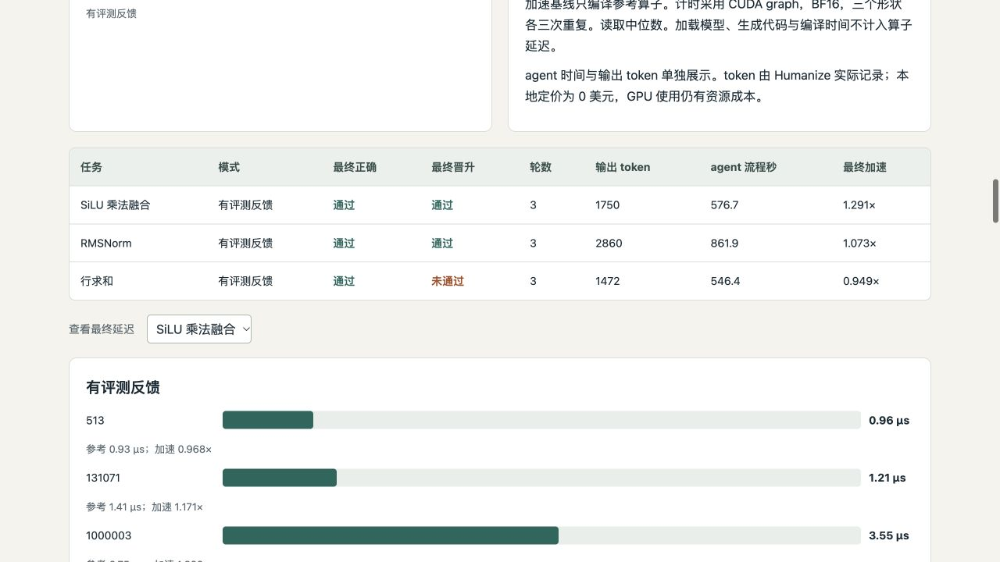
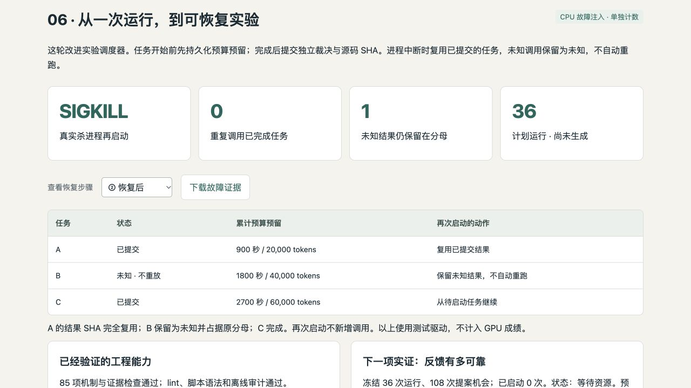
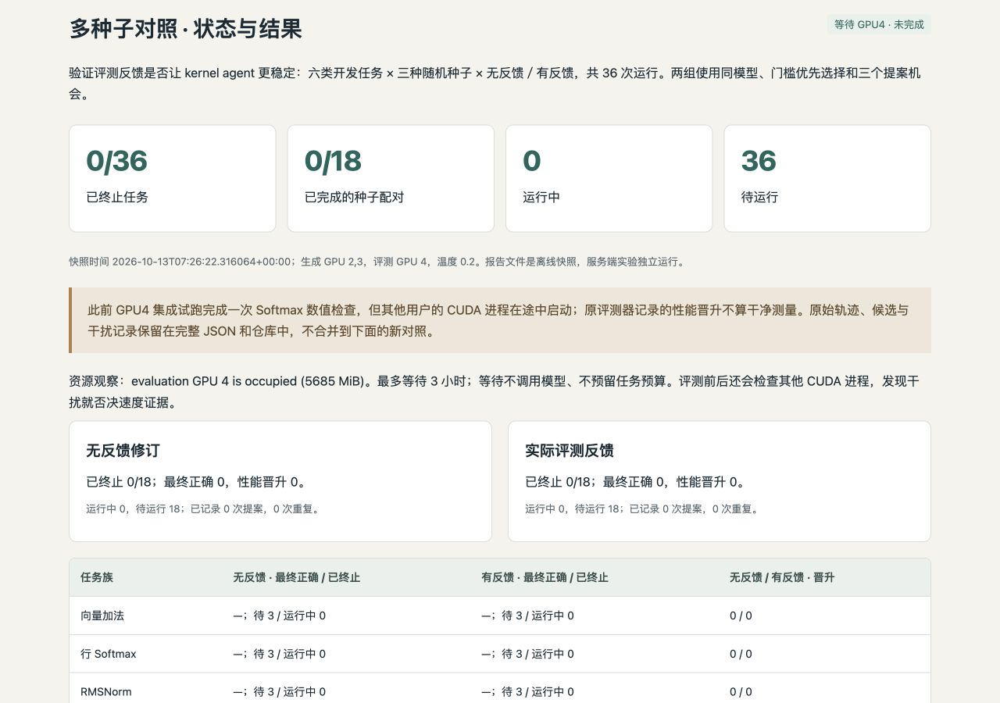

# Evidence-driven Kernel Agent Harness

This independent portfolio branch of `jasonchen505/kda` contains a downstream local-model
agent harness in [`kernel-agent/`](kernel-agent/). It adapts KDA's workflow through
Humanize/OpenCode and adds independent GPU evaluation, bounded repair, candidate selection
and auditable experiment evidence.

The research object is the **agent that writes kernels**. This project does not claim to
implement KDA, Humanize or Qwen, reproduce the complete KDA research pipeline, or count
handwritten kernels as agent successes. The original KDA documentation is preserved in
[README-kda-upstream.md](README-kda-upstream.md) and the workflow directories.

## Review the project

- [Project summary and contribution](kernel-agent/docs/project-summary.md)
- [中文简历与面试总结](kernel-agent/docs/project-summary.zh.md)
- [Implementation and installation](kernel-agent/README.md)
- [Interactive offline HTML report](kernel-agent/reports/kernel-agent-report.html)
- [Humanize upstream update and compatibility](kernel-agent/docs/humanize-update.md)
- [Publication verification](kernel-agent/docs/publication-verification.md)
- [Durable scheduling and SIGKILL recovery](kernel-agent/docs/campaign-recovery.md)
- [Prepared 36-job multi-seed study](kernel-agent/docs/multiseed-study-plan.md)
- [GPU4 execution, interference qualification and guarded plan](kernel-agent/docs/multiseed-execution.md)
- [Why GPU sharing and performance measurement differ](kernel-agent/docs/gpu-sharing-policy.md)

```bash
git clone --branch codex/kernel-agent-harness https://github.com/jasonchen505/kda.git
cd kda/kernel-agent
python3 scripts/verify_evidence.py       # Standard library; no CUDA or model required
uv sync --extra dev --frozen
uv run pytest
python3 -m http.server 8765 --bind 127.0.0.1
# Open http://127.0.0.1:8765/reports/kernel-agent-report.html
```

The local-model experiments require the separately documented Linux/GPU environments.
The review path above checks published evidence and controller mechanisms on a CPU.

## Result and scope

The latest three-task integration campaign produced **3/3 final-correct outputs and 2/3
performance promotions**. SiLU and RMSNorm achieved mean speedups of **1.291× and 1.073×**
on three BF16 shapes versus `torch.compile` on an RTX 4090. A preceding equal-budget
feedback/blind study produced 3/3 correct and 0/3 promoted in each arm.

These are separate small, reference-assisted studies, not a stable success-rate estimate.
Inference configuration changed between campaigns. The selector defect, fixed-source
rechecks, negative trials and causal limits are documented alongside the positive result.
The guarded harness passes **99 mechanism/interface/artifact checks** on both
pinned Humanize environments; the original measured campaign passed 54. A real SIGKILL
test reuses completed jobs, preserves unknown outcomes and allocations, and starts only
pending tasks. It uses synthetic model/GPU drivers, not additional generation trials.

The six-family × three-stochastic-seed × two-arm study is prepared (36 jobs). One earlier
GPU4 integration job made three real Qwen proposals and passed final numerical checks,
but a foreign CUDA process started during the job; its recorded promotion is explicitly
unqualified for clean performance. The new guarded campaign waits on user-selected GPU4
with finite resource waiting and pre/post evaluation checks. Full multi-seed results remain
pending. Strict occupancy is a conservative measurement policy, not a CUDA execution rule.







## License

Original KDA files retain the root license and notices. Original downstream harness code
is covered by [kernel-agent/LICENSE](kernel-agent/LICENSE); referenced Triton tutorials
retain MIT attribution in [the downstream notices](kernel-agent/THIRD_PARTY_NOTICES.md).
Model weights and Humanize/OpenCode source are not redistributed.
