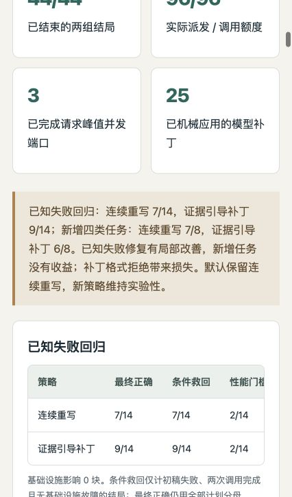

# Evidence-driven Kernel Agent Harness

This independent portfolio branch of `jasonchen505/kda` contains a downstream local-model
agent harness in [`kernel-agent/`](kernel-agent/). It adapts KDA's workflow through
Humanize/OpenCode and adds independent GPU evaluation, bounded repair, candidate selection
and auditable experiment evidence.

The research object is the **agent that writes kernels**. This project does not claim to
implement KDA, Humanize or Qwen, reproduce the complete KDA research pipeline, or count
handwritten kernels as agent successes. The original KDA documentation is preserved in
[README-kda-upstream.md](README-kda-upstream.md) and the workflow directories.

## Review the project

- [Project summary and contribution](kernel-agent/docs/project-summary.md)
- [中文简历与面试总结](kernel-agent/docs/project-summary.zh.md)
- [Implementation and installation](kernel-agent/README.md)
- [Interactive offline HTML report](kernel-agent/reports/kernel-agent-report.html)
- [Humanize upstream update and compatibility](kernel-agent/docs/humanize-update.md)
- [Publication verification](kernel-agent/docs/publication-verification.md)
- [Durable scheduling and SIGKILL recovery](kernel-agent/docs/campaign-recovery.md)
- [Prepared 36-job multi-seed study](kernel-agent/docs/multiseed-study-plan.md)
- [GPU4 execution, interference qualification and guarded plan](kernel-agent/docs/multiseed-execution.md)
- [Why GPU sharing and performance measurement differ](kernel-agent/docs/gpu-sharing-policy.md)
- [Online feedback with durable finalization](kernel-agent/docs/phased-study-plan.md)
- [Latest same-budget patch repair results](kernel-agent/docs/operational-study-results.zh.md)
- [Patch repair design](kernel-agent/docs/operational-study-plan.md)
- [Operational-study reproduction](kernel-agent/docs/operational-reproduction.md)
- [Grounded semantic repair: design](kernel-agent/docs/semantic-study-plan.md)
- [Previous three-arm results and limits](kernel-agent/docs/semantic-study-results.zh.md)
- [Failure analysis](kernel-agent/docs/semantic-failure-analysis.zh.md)
- [Semantic-study reproduction](kernel-agent/docs/semantic-reproduction.md)
- [Preceding generation and counterexample repair design](kernel-agent/docs/repair-study-plan.md)
- [Three-service execution results](kernel-agent/docs/service-pool-results.zh.md)
- [Recorded endpoint restart and handoff](kernel-agent/docs/service-pool-handoff.md)

```bash
git clone --branch codex/kernel-agent-harness https://github.com/jasonchen505/kda.git
cd kda/kernel-agent
python3 scripts/verify_evidence.py       # Standard library; no CUDA or model required
uv sync --extra dev --frozen
uv run pytest
python3 -m http.server 8765 --bind 127.0.0.1
# Open http://127.0.0.1:8765/reports/kernel-agent-report.html
```

The local-model experiments require the separately documented Linux/GPU environments.
The review path above checks published evidence and controller mechanisms on a CPU.

## Result and scope

The latest repair architecture derives numeric relations and coordinate witnesses from
trusted search probes and requests exact model-authored source patches. Transactions bind
the current SHA, apply atomically, and preserve the base after rejection. Each paired arm
gets two repair calls; the initial source and independent evaluator are shared.

The completed **22-block / 44-outcome / 96-call** study has mixed results:

| Separate stratum | Two rewrites | Evidence-guided patches |
|---|---:|---:|
| Known failed sources (7 parents, 2 seeds, 5 families) | 7/14 | 9/14 |
| New project-defined tasks (4 families, 2 seeds) | 7/8 | 6/8 |

All counts are independent final-correct outcomes. Family-equal paired differences are
+25pp (exploratory interval −30 to +70) and −12.5pp (−37.5 to 0); the raw regression
count difference is +14.3pp with different weighting. Strata stay separate. Patches rescue
old SiLU and one transpose source, but regress on row mean and a new L2 repair.
**17/42 patch transactions were rejected**. Keep ordinary repair as default; the patch
policy remains experimental. See [results and failures](kernel-agent/docs/operational-study-results.zh.md),
[prospective design](kernel-agent/docs/operational-study-plan.md), and
[reproduction](kernel-agent/docs/operational-reproduction.md).

The previous semantic review study (66 outcomes, 115 calls) found all arms equal:
7/14 regression and 7/8 fresh starts. The earlier factorial's 13/16 versus 15/16
negative result also remains unchanged. All **4847 prior evidence files** retain their
hashes. No post-outcome retries or human kernel fixes replace failures.

Three local Qwen processes use idle admission and latency EWMA; active blocks stay on
one process. This run reaches three concurrent model ports and 107 independent GPU4
windows with peak overlap one. GPU sharing is allowed, with child physical UUID proof.
**191 CPU tests** pass on both pinned SDKs and a fresh locked installation; fake-driver
tests are separate from model/GPU scores. No paid model API is used.

This is a research engineering prototype suitable for a portfolio, with measured local
repair gains and measured transfer limits. New tasks are not an external blind benchmark;
cache-root weight equality is unverified and shared ratios are not isolated or end-to-end
LLM speedups. Original KDA workflows and historical experiment denominators remain intact.



## License

Original KDA files retain the root license and notices. Original downstream harness code
is covered by [kernel-agent/LICENSE](kernel-agent/LICENSE); referenced Triton tutorials
retain MIT attribution in [the downstream notices](kernel-agent/THIRD_PARTY_NOTICES.md).
Model weights and Humanize/OpenCode source are not redistributed.
