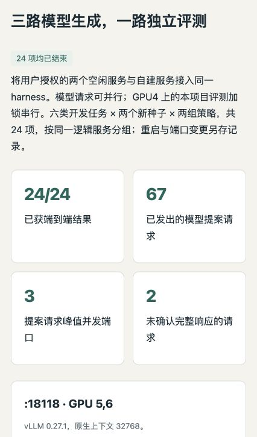
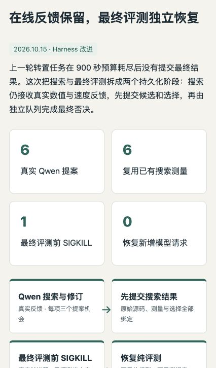

# Evidence-driven Kernel Agent Harness

This independent portfolio branch of `jasonchen505/kda` contains a downstream local-model
agent harness in [`kernel-agent/`](kernel-agent/). It adapts KDA's workflow through
Humanize/OpenCode and adds independent GPU evaluation, bounded repair, candidate selection
and auditable experiment evidence.

The research object is the **agent that writes kernels**. This project does not claim to
implement KDA, Humanize or Qwen, reproduce the complete KDA research pipeline, or count
handwritten kernels as agent successes. The original KDA documentation is preserved in
[README-kda-upstream.md](README-kda-upstream.md) and the workflow directories.

## Review the project

- [Project summary and contribution](kernel-agent/docs/project-summary.md)
- [中文简历与面试总结](kernel-agent/docs/project-summary.zh.md)
- [Implementation and installation](kernel-agent/README.md)
- [Interactive offline HTML report](kernel-agent/reports/kernel-agent-report.html)
- [Humanize upstream update and compatibility](kernel-agent/docs/humanize-update.md)
- [Publication verification](kernel-agent/docs/publication-verification.md)
- [Durable scheduling and SIGKILL recovery](kernel-agent/docs/campaign-recovery.md)
- [Prepared 36-job multi-seed study](kernel-agent/docs/multiseed-study-plan.md)
- [GPU4 execution, interference qualification and guarded plan](kernel-agent/docs/multiseed-execution.md)
- [Why GPU sharing and performance measurement differ](kernel-agent/docs/gpu-sharing-policy.md)
- [Online feedback with durable finalization](kernel-agent/docs/phased-study-plan.md)
- [Three-service execution results](kernel-agent/docs/service-pool-results.zh.md)
- [Recorded endpoint restart and handoff](kernel-agent/docs/service-pool-handoff.md)

```bash
git clone --branch codex/kernel-agent-harness https://github.com/jasonchen505/kda.git
cd kda/kernel-agent
python3 scripts/verify_evidence.py       # Standard library; no CUDA or model required
uv sync --extra dev --frozen
uv run pytest
python3 -m http.server 8765 --bind 127.0.0.1
# Open http://127.0.0.1:8765/reports/kernel-agent-report.html
```

The local-model experiments require the separately documented Linux/GPU environments.
The review path above checks published evidence and controller mechanisms on a CPU.

## Result and scope

The latest service-pool engineering validation completed **24/24 scheduled jobs**, across
six development families, two seeds and two strategies: **20/24 final-correct**,
**6/24 conditionally promoted**. Three local-model endpoints had overlapping proposer
requests; this project's GPU4 evaluator windows were serialized by a cooperative OS lock.
The reported peak is concurrency, not a measured end-to-end throughput speedup.

Two borrowed endpoints disappeared mid-run. A recorded, declaration-matched gateway
restored the logical entrances; **15 committed jobs were reused and nine untouched jobs
continued**, with 178 existing request/admission hashes unchanged and budgets retained.
Five strategy pairs cross the restart, so pooled feedback-effect intervals are suppressed.
Four jobs had no eligible source and never ran final evaluation; failed and uncertain
outcomes remain in the scheduled denominator.

The harness also persists online search measurements and source selection before a
separately resumable final veto. A previous real SIGKILL pilot reused six search records,
then made two independent final checks with zero new model/search calls. A fixed-source
selector contrast supports the gate-first defect fix. These distinct engineering and
model experiments keep separate denominators and runtime identities.

The CPU suite passes **134 cases** on both pinned Humanize SDKs and a fresh locked
installation. [Latest results and limits](kernel-agent/docs/service-pool-results.zh.md)
and [the endpoint handoff](kernel-agent/docs/service-pool-handoff.md) provide the details.
The earlier one-seed feedback study completed 12/12 jobs, without evidence of a feedback
advantage. The older guarded plan remains 23/36 terminal with 13 pending; it is not patched
using this new runtime.

Generated candidates are not manually repaired. Official Triton examples assist generation,
all families participated in development, cross-root weight equality is unverified, and
shared speed ratios against `torch.compile` do not establish isolated performance,
held-out generalization or production safety.





## License

Original KDA files retain the root license and notices. Original downstream harness code
is covered by [kernel-agent/LICENSE](kernel-agent/LICENSE); referenced Triton tutorials
retain MIT attribution in [the downstream notices](kernel-agent/THIRD_PARTY_NOTICES.md).
Model weights and Humanize/OpenCode source are not redistributed.
