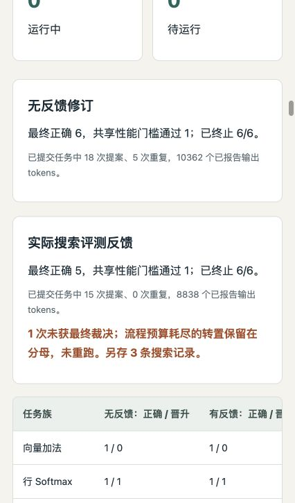

# Evidence-driven Kernel Agent Harness

This independent portfolio branch of `jasonchen505/kda` contains a downstream local-model
agent harness in [`kernel-agent/`](kernel-agent/). It adapts KDA's workflow through
Humanize/OpenCode and adds independent GPU evaluation, bounded repair, candidate selection
and auditable experiment evidence.

The research object is the **agent that writes kernels**. This project does not claim to
implement KDA, Humanize or Qwen, reproduce the complete KDA research pipeline, or count
handwritten kernels as agent successes. The original KDA documentation is preserved in
[README-kda-upstream.md](README-kda-upstream.md) and the workflow directories.

## Review the project

- [Project summary and contribution](kernel-agent/docs/project-summary.md)
- [中文简历与面试总结](kernel-agent/docs/project-summary.zh.md)
- [Implementation and installation](kernel-agent/README.md)
- [Interactive offline HTML report](kernel-agent/reports/kernel-agent-report.html)
- [Humanize upstream update and compatibility](kernel-agent/docs/humanize-update.md)
- [Publication verification](kernel-agent/docs/publication-verification.md)
- [Durable scheduling and SIGKILL recovery](kernel-agent/docs/campaign-recovery.md)
- [Prepared 36-job multi-seed study](kernel-agent/docs/multiseed-study-plan.md)
- [GPU4 execution, interference qualification and guarded plan](kernel-agent/docs/multiseed-execution.md)
- [Why GPU sharing and performance measurement differ](kernel-agent/docs/gpu-sharing-policy.md)
- [Online feedback with durable finalization](kernel-agent/docs/phased-study-plan.md)

```bash
git clone --branch codex/kernel-agent-harness https://github.com/jasonchen505/kda.git
cd kda/kernel-agent
python3 scripts/verify_evidence.py       # Standard library; no CUDA or model required
uv sync --extra dev --frozen
uv run pytest
python3 -m http.server 8765 --bind 127.0.0.1
# Open http://127.0.0.1:8765/reports/kernel-agent-report.html
```

The local-model experiments require the separately documented Linux/GPU environments.
The review path above checks published evidence and controller mechanisms on a CPU.

## Result and scope

The completed six-family, two-arm, one-seed feedback comparison has **12/12 terminal
jobs**: blind refinement is **6/6 final-correct and 1/6 promoted**; measured feedback
is **5/6 final-correct and 1/6 promoted**. One feedback task exhausted its 900-second
budget without a final verdict. Its three search records, generated sources and failed
outcome are preserved. This study does not establish a feedback advantage.

The controller now supports online search timing feedback followed by a separately
resumable final queue. It commits proposals, search measurements and search-only selection
before final-data access. Recovery reuses committed work; the final check can veto the
selected source without selecting an alternative. The latest engineering pilot and its
real process-kill boundary are documented in the report and verification notes. It
reused six search measurements and ran two independent final checks after SIGKILL,
with zero new model or search calls: 2/2 final-correct, 1/2 conditionally promoted.
The CPU suite passes 119 tests on both pinned SDKs and a fresh locked installation.

Earlier three-task integration produced 3/3 final-correct and 2/3 promoted; fixed-source
rechecks support a selector defect fix. The old guarded 36-job plan remains at 23 terminal
jobs and 13 pending. These experiments keep separate denominators and runtime identities.
Generated candidates are not manually repaired, and speed ratios against `torch.compile`
are conditional on the observed shared-device policy. Official Triton examples assist
generation; the experiments do not establish held-out generalization or production safety.




## License

Original KDA files retain the root license and notices. Original downstream harness code
is covered by [kernel-agent/LICENSE](kernel-agent/LICENSE); referenced Triton tutorials
retain MIT attribution in [the downstream notices](kernel-agent/THIRD_PARTY_NOTICES.md).
Model weights and Humanize/OpenCode source are not redistributed.
