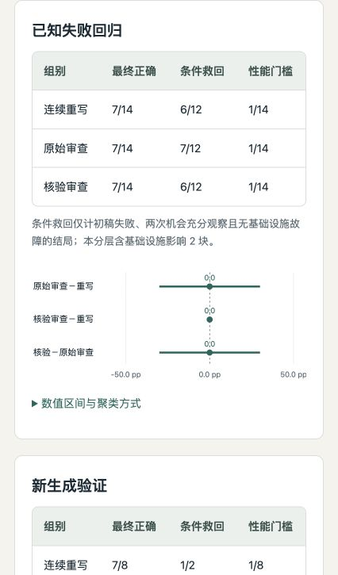

# Evidence-driven Kernel Agent Harness

This independent portfolio branch of `jasonchen505/kda` contains a downstream local-model
agent harness in [`kernel-agent/`](kernel-agent/). It adapts KDA's workflow through
Humanize/OpenCode and adds independent GPU evaluation, bounded repair, candidate selection
and auditable experiment evidence.

The research object is the **agent that writes kernels**. This project does not claim to
implement KDA, Humanize or Qwen, reproduce the complete KDA research pipeline, or count
handwritten kernels as agent successes. The original KDA documentation is preserved in
[README-kda-upstream.md](README-kda-upstream.md) and the workflow directories.

## Review the project

- [Project summary and contribution](kernel-agent/docs/project-summary.md)
- [中文简历与面试总结](kernel-agent/docs/project-summary.zh.md)
- [Implementation and installation](kernel-agent/README.md)
- [Interactive offline HTML report](kernel-agent/reports/kernel-agent-report.html)
- [Humanize upstream update and compatibility](kernel-agent/docs/humanize-update.md)
- [Publication verification](kernel-agent/docs/publication-verification.md)
- [Durable scheduling and SIGKILL recovery](kernel-agent/docs/campaign-recovery.md)
- [Prepared 36-job multi-seed study](kernel-agent/docs/multiseed-study-plan.md)
- [GPU4 execution, interference qualification and guarded plan](kernel-agent/docs/multiseed-execution.md)
- [Why GPU sharing and performance measurement differ](kernel-agent/docs/gpu-sharing-policy.md)
- [Online feedback with durable finalization](kernel-agent/docs/phased-study-plan.md)
- [Grounded semantic repair: design](kernel-agent/docs/semantic-study-plan.md)
- [Latest three-arm results and limits](kernel-agent/docs/semantic-study-results.zh.md)
- [Failure analysis](kernel-agent/docs/semantic-failure-analysis.zh.md)
- [Semantic-study reproduction](kernel-agent/docs/semantic-reproduction.md)
- [Preceding generation and counterexample repair design](kernel-agent/docs/repair-study-plan.md)
- [Three-service execution results](kernel-agent/docs/service-pool-results.zh.md)
- [Recorded endpoint restart and handoff](kernel-agent/docs/service-pool-handoff.md)

```bash
git clone --branch codex/kernel-agent-harness https://github.com/jasonchen505/kda.git
cd kda/kernel-agent
python3 scripts/verify_evidence.py       # Standard library; no CUDA or model required
uv sync --extra dev --frozen
uv run pytest
python3 -m http.server 8765 --bind 127.0.0.1
# Open http://127.0.0.1:8765/reports/kernel-agent-report.html
```

The local-model experiments require the separately documented Linux/GPU environments.
The review path above checks published evidence and controller mechanisms on a CPU.

## Result and scope

The latest iteration adds an independent semantic reviewer and a bounded AST interpreter
that checks expressions against trusted asymmetric FP32 probes. The grounded writer sees
verified expressions and factual traces, with unverified narratives filtered. Its three-arm,
22-block study resolves all **66 outcomes**, with **115 actual model dispatches**:

| Separate stratum | Two rewrites | Raw reviewer + writer | Grounded reviewer + writer |
|---|---:|---:|---:|
| Known-failure regression (7 parents, 2 seeds, 5 families) | 7/14 | 7/14 | 7/14 |
| Fresh starts (8 existing families, 1 seed) | 7/8 | 7/8 | 7/8 |

All entries are final-correct counts. Each arm has two extra model opportunities; the last
two arms share the exact review, and get one new kernel rather than two. Strata and paired
cluster intervals remain separate. Mathematical agreement does not prove API or layout
correctness. Keep ordinary generation/repair as the default; semantic variants remain
experimental. See [results and uncertainty](kernel-agent/docs/semantic-study-results.zh.md).

The preceding factorial remains unchanged: contract+diagnostic repair 13/16 final-correct,
ordinary generation/repair 15/16, 152 calls. Its missing-factor and layout failures motivate
the new mechanism. All 3700 previously published result/frozen-analysis files retain their
hashes. No generated kernel is manually patched and negative outcomes are not replaced.

Three local Qwen services use dynamic discovery, idle admission and latency-EWMA allocation;
active blocks bind one process, unknown calls are not replayed, and independent GPU4 work
is cooperatively serialized with physical UUID proof. **176 CPU tests** pass independently
on both pinned SDKs and a fresh locked install. Their fake-driver mechanism fixtures are
separate from real model/GPU evidence. No paid model API is used.

Earlier pooling, endpoint recovery, selector and SIGKILL experiments retain independent
denominators. This small regression/fresh evaluation is not a blind external benchmark;
weight equality across cached roots is unverified. Shared kernel ratios are not isolated
or end-to-end LLM speedups. The original KDA workflows remain available unchanged.



## License

Original KDA files retain the root license and notices. Original downstream harness code
is covered by [kernel-agent/LICENSE](kernel-agent/LICENSE); referenced Triton tutorials
retain MIT attribution in [the downstream notices](kernel-agent/THIRD_PARTY_NOTICES.md).
Model weights and Humanize/OpenCode source are not redistributed.
