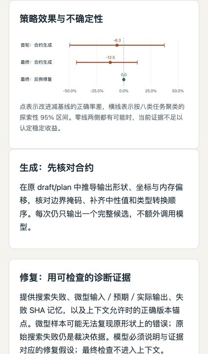

# Evidence-driven Kernel Agent Harness

This independent portfolio branch of `jasonchen505/kda` contains a downstream local-model
agent harness in [`kernel-agent/`](kernel-agent/). It adapts KDA's workflow through
Humanize/OpenCode and adds independent GPU evaluation, bounded repair, candidate selection
and auditable experiment evidence.

The research object is the **agent that writes kernels**. This project does not claim to
implement KDA, Humanize or Qwen, reproduce the complete KDA research pipeline, or count
handwritten kernels as agent successes. The original KDA documentation is preserved in
[README-kda-upstream.md](README-kda-upstream.md) and the workflow directories.

## Review the project

- [Project summary and contribution](kernel-agent/docs/project-summary.md)
- [中文简历与面试总结](kernel-agent/docs/project-summary.zh.md)
- [Implementation and installation](kernel-agent/README.md)
- [Interactive offline HTML report](kernel-agent/reports/kernel-agent-report.html)
- [Humanize upstream update and compatibility](kernel-agent/docs/humanize-update.md)
- [Publication verification](kernel-agent/docs/publication-verification.md)
- [Durable scheduling and SIGKILL recovery](kernel-agent/docs/campaign-recovery.md)
- [Prepared 36-job multi-seed study](kernel-agent/docs/multiseed-study-plan.md)
- [GPU4 execution, interference qualification and guarded plan](kernel-agent/docs/multiseed-execution.md)
- [Why GPU sharing and performance measurement differ](kernel-agent/docs/gpu-sharing-policy.md)
- [Online feedback with durable finalization](kernel-agent/docs/phased-study-plan.md)
- [Generation and counterexample repair design](kernel-agent/docs/repair-study-plan.md)
- [Three-service execution results](kernel-agent/docs/service-pool-results.zh.md)
- [Recorded endpoint restart and handoff](kernel-agent/docs/service-pool-handoff.md)

```bash
git clone --branch codex/kernel-agent-harness https://github.com/jasonchen505/kda.git
cd kda/kernel-agent
python3 scripts/verify_evidence.py       # Standard library; no CUDA or model required
uv sync --extra dev --frozen
uv run pytest
python3 -m http.server 8765 --bind 127.0.0.1
# Open http://127.0.0.1:8765/reports/kernel-agent-report.html
```

The local-model experiments require the separately documented Linux/GPU environments.
The review path above checks published evidence and controller mechanisms on a CPU.

## Result and scope

The latest agent-policy study completed **64/64 factorial arm outcomes** on eight task
families and two seeds. First-proposal search correctness is **12/16** for ordinary
KDA prompting and **11/16** for a contract checklist. Full contract+counterexample
configuration is **13/16 final-correct**, versus **15/16** for ordinary generation
and repair. Shared-failure fully observed pairs: 8, with 5 ordinary versus 5
counterexample rescues. See [results and uncertainty](kernel-agent/docs/repair-study-results.zh.md).

**Decision: keep ordinary generation and repair as the recommendation.** The new policies remain experimental: contract prompting observed lower correctness, and diagnostic repair did not improve paired rescues. This is a completed negative result, not a demonstrated accuracy improvement. One GPU-monitor failure affects the primary denominator; the 15 fully observed blocks give 15/15 baseline versus 12/15 combined. The zero-width observed repair interval is not an equivalence test.

The controller adds contract/index/cast reasoning, tiny independent search witnesses,
failed-source memory and a correct-source anchor. The two repair arms import exactly
the same initial source and verdict, each with two further opportunities. Actual model
calls: **152/160**, not 64×3. All final selections commit before final-data access.
No generated kernel is manually patched.

The common native Chat backend removes auxiliary title calls. Dynamic Qwen discovery,
idle admission and latency-EWMA work allocation cover 3 GPU groups. An active
comparison block binds one model process; unknown calls are never replayed or migrated.
This is not a causal comparison with old OpenCode latency. The CPU suite passes **159 cases**
on both pinned SDKs and a fresh locked install, separate from model/GPU results.

Earlier 24-job pooling, recorded endpoint recovery, fixed-source selector contrast and
real SIGKILL finalization remain independently auditable. The old guarded 36-job plan
still has 23 terminal jobs and 13 pending. Eight current families include six developed
ones and two additions seen in an invalid device pre-run, not a blind external benchmark. Task-cluster
intervals are exploratory; cached roots' weight equality is unverified; shared kernel
ratios against torch.compile are not end-to-end LLM acceleration or production safety.



## License

Original KDA files retain the root license and notices. Original downstream harness code
is covered by [kernel-agent/LICENSE](kernel-agent/LICENSE); referenced Triton tutorials
retain MIT attribution in [the downstream notices](kernel-agent/THIRD_PARTY_NOTICES.md).
Model weights and Humanize/OpenCode source are not redistributed.
